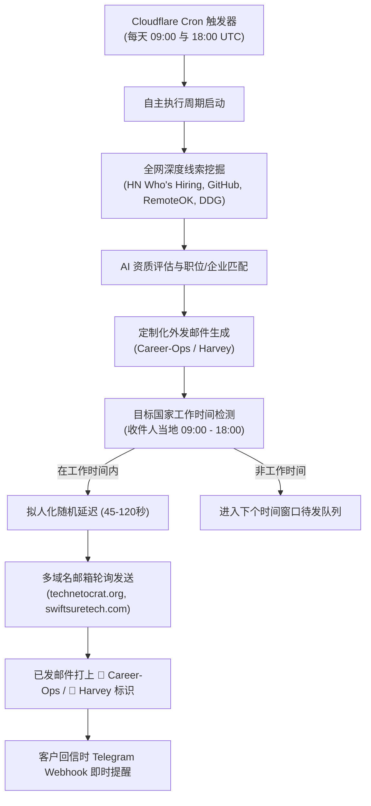

<p align="center">
    
    <h1 align="center">Cloud Mailreach</h1>
    <p align="center"><strong>基于 Cloudflare 的自主 AI 冷邮件获客与无服务器邮箱生态系统</strong></p>
    <p align="center">由 Cloudflare Workers、D1、Career-Ops 求职引擎与 Harvey B2B 拓客引擎驱动</p>
    <p align="center">
        <a href="https://www.cloudflare.com/" target="_blank">
            
        </a>
        <a href="https://github.com/tasinsohad/Cloudmailreach/releases" target="_blank">
            
        </a>
        <a href="https://github.com/tasinsohad/Cloudmailreach/blob/main/LICENSE" target="_blank">
            
        </a>
    </p>
    <p align="center">
        <a href="https://cloud-mail.sohad-flowtics.workers.dev">在线体验</a> · 
        <a href="#快速部署">部署指南</a> · 
        <a href="/README-en.md">English</a> | 简体中文
    </p>
</p>

---

## 🚀 项目概述

**Cloud Mailreach** 是一个端到端、完全基于 Cloudflare 边缘计算（Serverless）运行的自主 AI 邮件营销与智能邮箱综合平台。

它将支持多域名、多别名的企业级网页邮箱系统与两大自主 AI 挖掘 & 外发引擎深度融合：
1. **💼 Career-Ops（职业求职引擎）**：全自动扫描软件工程师、远程开发等工作机会，评估职位契合度并生成量身定制的高说服力求职信与邮件。
2. **🎯 Harvey（B2B 获客引擎）**：定向挖掘企业创始人、CTO、技术VP等核心决策者，分析企业技术栈并撰写顾问式高转化率冷邮件方案。

在**零独立服务器租用成本**的前提下，Cloud Mailreach 实现自主定时线索挖掘、收件人所在国家工作时间投递、真人化随机延迟发送、多域名邮箱轮询以及 Telegram 回信即时推送。

---

## 🌟 核心特性

### 🤖 自主 AI 拓客与求职引擎
- **Career-Ops（自主求职机器人）**：
  - 自动扫描全网优质招聘源（Hacker News *Who is Hiring*、GitHub Jobs、RemoteOK、Jobicy、Himalayas、DevITJobs、Arxiv 及 DuckDuckGo 全网深度搜索）。
  - 结合开发者技术栈与优势自动评分筛选高价值岗位。
  - 针对企业具体技术痛点，自主生成真实自然的求职邮件与项目经历推介。
- **Harvey（自主 B2B 客户开发）**：
  - 深度检索目标企业技术决策人（CTO / VP / 创始人）。
  - 基于公司公开技术栈与痛点，生成高定制化价值型冷邮件。
- **Autonomous Auto Mode（每日 2 次深度巡检）**：
  - 内置 Cloudflare Worker 自动化定时任务（每天上午 9 点及下午 6 点执行）。
  - 深度搜寻 $\rightarrow$ 线索清洗 $\rightarrow$ AI 邮件生成 $\rightarrow$ 进入智能工作时间队列，全程无需人工干预。

### ⏰ 智能交付与拟人化反垃圾机制
- **收件人国家工作时间投递**：根据潜在客户所在国家与时区，仅在对方当地工作时间（上午 09:00 至下午 18:00）精准投递，确保邮件第一时间出现在收件箱顶部。
- **拟人化随机延迟发送**：邮件之间自动加入 45 ~ 120 秒真人化间隔，防止高频群发触发反垃圾风控，保障 SPF、DKIM、DMARC 域名信誉。
- **多域名邮箱集群轮换**：自动在绑定的多个企业域名之间轮换发信（例如 `technetocrat.org`、`swiftsuretech.com`、`nccwtech.com`、`saiftechnology.com`）。
- **已发送邮件智能标识**：已发邮件列表与详情页中实时显示专属彩色徽标（💼 **`Career-Ops`** 与 🎯 **`Harvey`**），清晰区分不同业务流。

### 📱 响应式移动端控制台
- **毛玻璃极简美学界面**：完美适配手机移动端浏览器、平板及宽屏桌面。
- **实时数据看板**：直观展示线索挖掘总量、待发队列、已发数、回信数与投递健康度。
- **一键即时操作**：支持随时手动触发深度搜索、一键批量发送、测试 Telegram 机器人通信。
- **多 AI 模型即时切换**：支持 OpenRouter（Claude 3.5 Sonnet、DeepSeek V3/R1、GPT-4o）以及 Cloudflare Workers AI 本地模型。

### ✉️ 全功能无服务器邮箱平台
- **多域名邮箱管理**：单个控制台统一管理多个独立域名邮箱，支持一键创建无限临时/长效别名。
- **多样化发信渠道**：原生支持 Cloudflare Email Routing、Resend 以及 Brevo 高可用邮件发送通道。
- **R2 附件存储**：无缝集成 Cloudflare R2 对象存储，支持大文件附件收发与安全下载。
- **Telegram 实时推送与一键回复**：收到潜在客户或招聘团队回信时，即刻向 Telegram 机器人推送通知，附带邮件摘要与**一键直达回复**按钮。
- **Workers AI 验证码智能提取**：接收验证码邮件时，通过边缘 AI 自动识别并提取 OTP 验证码。

---

## 🛠️ 技术栈与架构

| 架构层 | 使用技术 |
| :--- | :--- |
| **边缘计算 (Serverless)** | [Cloudflare Workers](https://developers.cloudflare.com/workers/) (基于 Hono 框架) |
| **数据库** | [Cloudflare D1](https://developers.cloudflare.com/d1/) (边缘 SQLite + Drizzle ORM) |
| **键值与缓存** | [Cloudflare KV](https://developers.cloudflare.com/kv/) |
| **文件存储** | [Cloudflare R2](https://developers.cloudflare.com/r2/) (兼容 S3 API) |
| **前端应用** | [Vue 3](https://vuejs.org/) + [Element Plus](https://element-plus.org/) + [Vite](https://vitejs.dev/) + [Pinia](https://pinia.vuejs.org/) + [ECharts](https://echarts.apache.org/) |
| **AI 推理** | [OpenRouter](https://openrouter.ai/) / [Cloudflare Workers AI](https://developers.cloudflare.com/workers-ai/) |
| **邮件投递** | Cloudflare Email Routing / [Resend](https://resend.com/) / [Brevo](https://www.brevo.com/) |

---

## 📁 目录结构

```
Cloudmailreach
├── mail-worker                     # 后端 Cloudflare Worker 边缘服务
│   ├── src
│   │   ├── api                     # RESTful API 路由 (outreach、email、admin、auth)
│   │   ├── const                   # 系统全局常量配置
│   │   ├── entity                  # Drizzle ORM 数据库定义 (email、leads、campaigns)
│   │   ├── hono                    # Hono 应用入口、中间件与跨域处理
│   │   ├── init                    # 数据库初始化及 D1 自动增量迁移
│   │   ├── security                # JWT 鉴权与 RBAC 权限控制
│   │   ├── service                 # 核心业务逻辑 (邮件收发、外发引擎、Telegram通知、AI对接)
│   │   ├── utils                   # 爬取解析器、国家时区推断、数据格式化
│   │   └── index.js                # Worker 主入口与 Cron 定时调度触发器
│   ├── package.json
│   └── wrangler.toml               # Cloudflare 资源绑定与环境配置
│
├── mail-vue                        # 前端 Vue 3 单页面应用 (SPA)
│   ├── src
│   │   ├── components              # 公共组件 (虚拟邮件滚动列表、富文本编辑器)
│   │   ├── views
│   │   │   ├── outreach            # Outreach 拓客与求职控制中心 (Career-Ops & Harvey)
│   │   │   ├── send                # 已发邮件列表 (含营销活动专属彩色徽标)
│   │   │   ├── content             # 邮件详情阅读器
│   │   │   ├── inbox               # 多域名收件箱
│   │   │   └── sys-setting         # 系统配置与账户管理
│   │   ├── router                  # 路由管理
│   │   └── store                   # Pinia 状态管理
│   ├── package.json
│   └── index.html                  # 响应式 HTML 入口
│
├── sync-sourcing-engines.mjs       # 本地获客队列同步辅助脚本
└── README.md                       # 说明文档
```

---

## ⚡ 快速部署

### 1. 准备环境
- 安装 [Node.js](https://nodejs.org/) (v20+) 与 [pnpm](https://pnpm.io/)
- 准备一个 [Cloudflare 账号](https://dash.cloudflare.com/)
- 全局安装 Wrangler CLI：
```bash
npm install -g wrangler
```

### 2. 克隆项目
```bash
git clone https://github.com/tasinsohad/Cloudmailreach.git
cd Cloudmailreach
```

### 3. 配置后端参数 (`mail-worker`)
编辑 `mail-worker/wrangler.toml` 绑定你的 Cloudflare 资源：
```toml
name = "cloud-mail"
main = "src/index.js"
compatibility_date = "2025-06-04"

[[d1_databases]]
binding = "db"
database_name = "cloud-mail-db"
database_id = "<你的_D1_DATABASE_ID>"

[[kv_namespaces]]
binding = "kv"
id = "<你的_KV_NAMESPACE_ID>"

[triggers]
crons = ["0 9,18 * * *", "0 * * * *"]

[vars]
jwt_secret = "<你的随机密钥>"
domain = ["yourdomain1.com", "yourdomain2.com"]
admin = "admin@yourdomain1.com"
```

通过 Wrangler 录入敏感密钥（例如 Brevo API Key）：
```bash
npx wrangler secret put brevo_api_key -c mail-worker/wrangler.toml
```

### 4. 编译前端
```bash
cd mail-vue
pnpm install
pnpm build
cd ..
```
编译产物会自动输出至 `mail-worker/dist`。

### 5. 部署到 Cloudflare Workers
```bash
cd mail-worker
pnpm install
npx wrangler deploy
```

---

## ⚙️ 自主外发运作流程



---

## 📄 开源许可

本项目遵循 [MIT License](LICENSE) 开源协议。

---

## 🤝 交流与反馈

- **开源仓库**: [tasinsohad/Cloudmailreach](https://github.com/tasinsohad/Cloudmailreach)
- **提交反馈与 Issue**: [GitHub Issues](https://github.com/tasinsohad/Cloudmailreach/issues)
