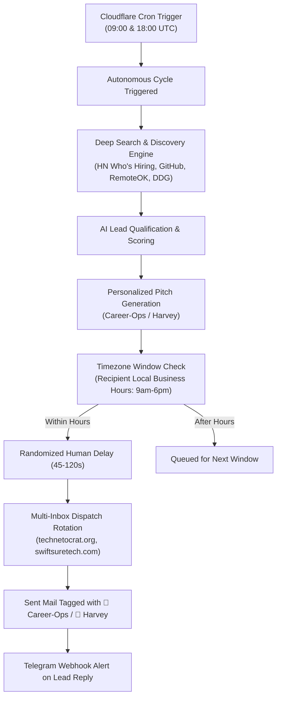

<p align="center">
    
    <h1 align="center">Cloud Mailreach</h1>
    <p align="center"><strong>Autonomous AI Cold Outreach & Serverless Mail Ecosystem</strong></p>
    <p align="center">Powered by Cloudflare Workers, D1, Career-Ops & Harvey Engines</p>
    <p align="center">
        <a href="https://www.cloudflare.com/" target="_blank">
            
        </a>
        <a href="https://github.com/tasinsohad/Cloudmailreach/releases" target="_blank">
            
        </a>
        <a href="https://github.com/tasinsohad/Cloudmailreach/blob/main/LICENSE" target="_blank">
            
        </a>
    </p>
    <p align="center">
        <a href="https://cloud-mail.sohad-flowtics.workers.dev">Live Application</a> · 
        <a href="#quick-start">Deployment Guide</a> · 
        English | <a href="/README-zh.md">简体中文</a>
    </p>
</p>

---

## 🚀 Overview

**Cloud Mailreach** is an end-to-end autonomous email operations and AI cold outreach platform running 100% serverless at the edge on Cloudflare. 

It unifies a multi-domain enterprise-grade webmail client with two autonomous AI sourcing & outreach engines:
1. **💼 Career-Ops**: Discovers software engineering jobs, remote opportunities, and tech hiring teams, qualifying leads and pitching tailored applications.
2. **🎯 Harvey**: Sources B2B corporate prospects, founders, CTOs, and decision-makers, researching tech stacks to send high-converting partnership pitches.

With **zero dedicated server hosting fees**, Cloud Mailreach handles scheduled lead sourcing, target-timezone delivery windows, anti-spam randomized delays, multi-inbox rotation, and instant Telegram reply notifications.

---

## 🌟 Key Highlights

### 🤖 Autonomous Outreach Engines
- **Career-Ops (Autonomous Job Hunter)**:
  - Continuously searches web sources (Hacker News *Who is Hiring*, GitHub Jobs, RemoteOK, Jobicy, Himalayas, DevITJobs, Arxiv, and DuckDuckGo).
  - Evaluates job posts against developer profile strengths, tech stack criteria, and salary expectations.
  - Automatically synthesizes hyper-personalized cold cover emails addressing exact company pain points.
- **Harvey (Autonomous Client Acquisition)**:
  - Deep-scrapes company info, decision-maker contacts (CTO, VP Eng, Founder), and tech infrastructures.
  - Generates value-first consultative email proposals with natural, non-templated copywriting.
- **Autonomous Auto Mode (2x Daily Sourcing)**:
  - Built-in Cloudflare Worker cron triggers run twice daily deep sweeps (`0 9,18 * * *`).
  - Searches $\rightarrow$ Qualifies $\rightarrow$ Generates Drafts $\rightarrow$ Schedules Timezone Drips without any manual intervention.

### ⏰ Deliverability & Human Sending Engine
- **Target-Timezone Awareness**: Restricts email dispatching to business hours (09:00 AM – 06:00 PM) in each prospect's regional timezone so messages land at the top of their morning inbox.
- **Anti-Spam Human Drip**: Enforces randomized human-like delays (45 to 120 seconds between sends) to safeguard domain reputation and preserve SPF/DKIM/DMARC health.
- **Multi-Domain Inbox Swarm**: Rotates dispatches seamlessly across your connected domains (`technetocrat.org`, `swiftsuretech.com`, `nccwtech.com`, `saiftechnology.com`, etc.).
- **Visual Sent Mail Badging**: Identifies dispatched emails immediately in the sent mailbox and detail viewer with dedicated badges (`💼 Career-Ops` vs `🎯 Harvey`).

### 📱 Responsive Outreach Command Center
- **Mobile-First Glassmorphism UI**: Access and control the entire outreach lifecycle from smartphones, tablets, or widescreen monitors.
- **Live Pipeline Metrics**: Visual gauges for total prospects sourced, queued, emailed, responded, and bounce/error rates.
- **One-Click Manual Controls**: Trigger instant deep searches, test Telegram connections, or dispatch batches on-demand.
- **AI Model Switcher**: Seamlessly toggle between OpenRouter (Claude 3.5 Sonnet, DeepSeek V3/R1, GPT-4o) and Workers AI.

### ✉️ Full Serverless Webmail System
- **Multi-Domain Inbox Management**: Unlimited custom domain aliases, catch-all routing, and instant disposable email addresses.
- **Multi-Provider Dispatch**: High-deliverability routing via Cloudflare Email Routing, Resend, or Brevo.
- **Rich Attachments via R2**: Direct S3-compatible file storage powered by Cloudflare R2.
- **Instant Telegram Push**: Forward incoming messages to Telegram with a **1-Click Reply** shortcut.
- **Verification Code AI Extractor**: Automatically detects 2FA verification codes and OTP tokens in received mail using Cloudflare Workers AI.

---

## 🛠️ Tech Stack & Architecture

| Layer | Technologies |
| :--- | :--- |
| **Edge Compute** | [Cloudflare Workers](https://developers.cloudflare.com/workers/) (Hono Web Framework) |
| **Database** | [Cloudflare D1](https://developers.cloudflare.com/d1/) (Serverless SQLite + Drizzle ORM) |
| **Caching & KV** | [Cloudflare KV](https://developers.cloudflare.com/kv/) |
| **Object Storage**| [Cloudflare R2](https://developers.cloudflare.com/r2/) (S3 API) |
| **Frontend UI** | [Vue 3](https://vuejs.org/), [Element Plus](https://element-plus.org/), [Vite](https://vitejs.dev/), [Pinia](https://pinia.vuejs.org/), [ECharts](https://echarts.apache.org/) |
| **AI Inference** | [OpenRouter](https://openrouter.ai/) / [Cloudflare Workers AI](https://developers.cloudflare.com/workers-ai/) |
| **Email Delivery**| Cloudflare Email Routing / [Resend](https://resend.com/) / [Brevo](https://www.brevo.com/) |

---

## 📁 Repository Structure

```
Cloudmailreach
├── mail-worker                     # Serverless Cloudflare Worker Backend
│   ├── src
│   │   ├── api                     # REST API routers (outreach, email, admin, auth)
│   │   ├── const                   # System constants and enum mappings
│   │   ├── entity                  # Drizzle ORM database schemas (email, leads, campaigns)
│   │   ├── hono                    # Hono app instance, middlewares & CORS
│   │   ├── init                    # Database initialization & automated D1 migrations
│   │   ├── security                # JWT authentication & RBAC permissions
│   │   ├── service                 # Core business logic (Email, Outreach, Telegram, AI)
│   │   ├── utils                   # Sourcing parsers, timezone logic, formatting
│   │   └── index.js                # Worker entry point & Scheduled Cron Handlers
│   ├── package.json
│   └── wrangler.toml               # Cloudflare configuration & bindings
│
├── mail-vue                        # Vue 3 Single Page Application (SPA)
│   ├── src
│   │   ├── components              # Shared UI components (email-scroll, rich editor)
│   │   ├── views
│   │   │   ├── outreach            # Outreach Hub (Career-Ops & Harvey Dashboard)
│   │   │   ├── send                # Sent mailbox view with campaign badging
│   │   │   ├── content             # Email detail reader
│   │   │   ├── inbox               # Multi-inbox viewer
│   │   │   └── sys-setting         # System configuration & account management
│   │   ├── router                  # Vue Router configuration
│   │   └── store                   # Pinia state stores
│   ├── package.json
│   └── index.html                  # HTML entry point with responsive viewport
│
├── sync-sourcing-engines.mjs       # Bridge script for syncing external sourcing queues
└── README.md                       # Documentation
```

---

## ⚡ Quick Start

### 1. Prerequisites
- [Node.js](https://nodejs.org/) (v20+) and [pnpm](https://pnpm.io/)
- [Cloudflare Account](https://dash.cloudflare.com/)
- [Wrangler CLI](https://developers.cloudflare.com/workers/wrangler/install-and-update/) installed (`npm install -g wrangler`)

### 2. Clone the Repository
```bash
git clone https://github.com/tasinsohad/Cloudmailreach.git
cd Cloudmailreach
```

### 3. Configure Backend (`mail-worker`)
In `mail-worker/wrangler.toml`, ensure your Cloudflare resources are bound:
```toml
name = "cloud-mail"
main = "src/index.js"
compatibility_date = "2025-06-04"

[[d1_databases]]
binding = "db"
database_name = "cloud-mail-db"
database_id = "<YOUR_D1_DATABASE_ID>"

[[kv_namespaces]]
binding = "kv"
id = "<YOUR_KV_NAMESPACE_ID>"

[triggers]
crons = ["0 9,18 * * *", "0 * * * *"]

[vars]
jwt_secret = "<YOUR_RANDOM_SECRET>"
domain = ["yourdomain1.com", "yourdomain2.com"]
admin = "admin@yourdomain1.com"
```

Configure confidential secrets via Wrangler:
```bash
npx wrangler secret put brevo_api_key -c mail-worker/wrangler.toml
```

### 4. Build the Frontend
```bash
cd mail-vue
pnpm install
pnpm build
cd ..
```
The compiled assets will be written directly into `mail-worker/dist`.

### 5. Deploy to Cloudflare Workers
```bash
cd mail-worker
pnpm install
npx wrangler deploy
```

---

## ⚙️ How Autonomous Outreach Works



---

## 📄 License

This project is open-source under the [MIT License](LICENSE).

---

## 🤝 Community & Support

- **Repository**: [tasinsohad/Cloudmailreach](https://github.com/tasinsohad/Cloudmailreach)
- **Issues & Requests**: [GitHub Issues](https://github.com/tasinsohad/Cloudmailreach/issues)
